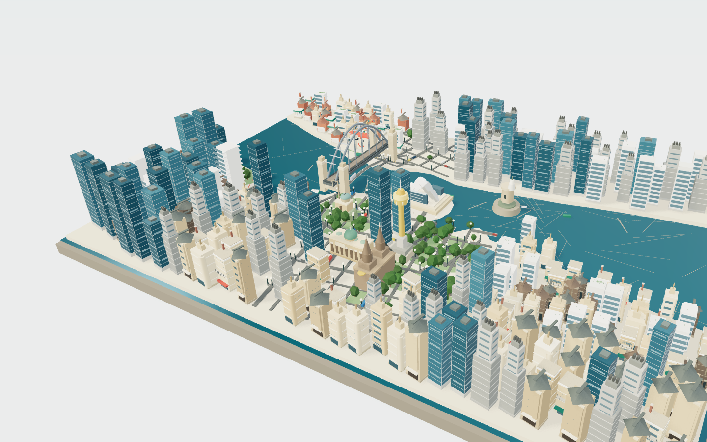
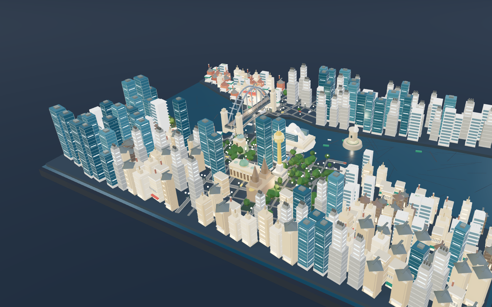

# Sydney Miniature

**A harbour cut in sandstone. Ferries in every direction.**

A from-scratch, offline Three.js diorama of central Sydney. A drowned-valley harbour separates the
CBD and The Rocks from the North Shore; eight landmarks, nine ordinary building families, the
Harbour Bridge, ferries, light rail, trains, day/night lighting and an English interface. The
release is one self-contained HTML file with no external assets or network calls.

**Live:** <https://somphol.github.io/sydney-miniature/>

It is an interpretive miniature, not a survey map, GIS viewer or navigation app.

| Day | Night |
| --- | --- |
|  |  |

Landmark flights: [Opera House](docs/preview-opera.png) · [Harbour Bridge](docs/preview-bridge.png)

## What is in it

- **Geography:** the harbour basin, Darling Harbour and Circular Quay, Farm Cove and
  Woolloomooloo Bay, the Bennelong and Mrs Macquarie headlands, Fort Denison island, the North
  Shore ridge, the Botanic Garden and Domain.
- **Eight landmarks:** Sydney Opera House, Harbour Bridge, Sydney Tower, Queen Victoria Building,
  St Mary's Cathedral, Luna Park, Fort Denison and Sydney Observatory.
- **Nine ordinary families:** sandstone terrace, Federation house, Art Deco apartment, concrete
  tower, glass tower, harbour apartment, wharf warehouse, sandstone institution and ferry pavilion.
- **A connected plan:** the tilted CBD grid, The Rocks lanes, the North Shore grid, 428 road edges
  and 268 building parcels, with the Harbour Bridge as the only crossing.
- **City life:** ferries, a catamaran, yachts, a cruise boat and a tug; light rail on George Street;
  a double-deck train on the bridge; buses, taxis, cars, vans and 64 pedestrians.
- **One file:** about 877 KiB, self-contained, no external requests, system fonts only.

## Run it

```sh
npm install
npm run dev          # Vite, http://localhost:5173
npm run test         # plan + geometry, no browser
npm run verify       # deterministic browser gate, 21 checks
npm run build:single # one offline file in dist-single/index.html
```

`verify` needs Chrome; `CHROME_PATH` overrides the executable. Under SwiftShader it takes about two
minutes. `npm run shot` writes visual-review images to `shots/` (ignored by git) and the committed
release previews live in `docs/`.

## URL parameters

- `lang=en` — the interface language (English is the only locale).
- `embed=1` — hides the header and intro for iframes; the landmark bar fits 345 × 345.
- `quality=low|high` — forces a rendering tier.
- `capture=1` — freezes wall-clock animation; `window.__scene.step(n, dt)` advances virtual time.
- `view=bridge|opera|harbour|north` — debug starting viewpoint, ignored in capture mode.

## Architecture

Construction order: **geography → plan → buildings/landmarks → environment → traffic → scene → UI.**

- `src/scene/geo.ts` — land polygons, water, island, districts, parks, plazas, landmarks, envelopes.
- `src/scene/plan.ts` — named roads, grid/lane geometry, planar road graph, bridges, parcels, routes.
- `src/scene/buildings.ts` — nine ordinary families and district choices.
- `src/scene/landmarks.ts` — eight landmark models and the envelope table.
- `src/scene/environment.ts` — tray, water, land, roads, parks, trees, wharves, lamps.
- `src/scene/traffic.ts` — vehicles, ferries/boats and pedestrians on authored paths.
- `src/scene/scene.ts` — renderer, camera, flights, day/night, facts and the capture API.
- `src/App.tsx`, `src/i18n.ts`, `src/style.css` — UI, copy and layouts.
- `tests/plan.test.ts`, `tests/geometry.test.ts` — invariants; `scripts/verify.mjs` — browser gate.

The detailed design contract is [CITY.md](CITY.md). Working notes for the next agent are in
[AGENTS.md](AGENTS.md).

## Verification

The plan test asserts one connected road graph, land-to-land bridges with water midpoints, parcel
containment, non-overlap and road clearance. The geometry test asserts finite landmark geometry
inside its envelope and distinct ordinary families. The browser gate drives capture mode through
every landmark flight, day/night, reset, zoom, orbit, pan, rotate, the facts, English copy and the
345 × 345 embed, with zero console errors and zero external requests.

## Licence

MIT. Three.js, React and the rest of the production closure are listed in the generated
`dist/THIRD_PARTY_NOTICES.txt` and inlined into the single file. See [ATTRIBUTION.md](ATTRIBUTION.md).
